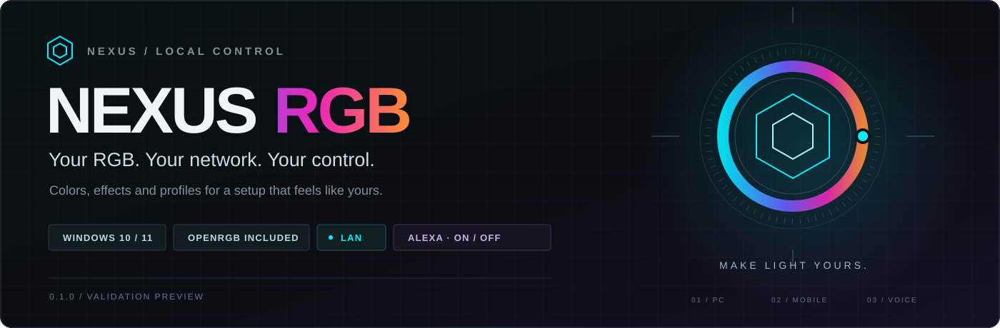

# ⚡ Nexus RGB Studio

[English](README-en.md) · [Português](README-pt.md) · [Documentation](docs/en/README.md)

**Your RGB, your network, your control.** Arrange your PC components on a 2D map, create or import lighting effects, and control your setup from a PC, phone or compatible Alexa Echo.

Nexus RGB is free, open source and experimental. It runs locally on Windows, includes OpenRGB Headless, and has a Portuguese/English interface. No Nexus cloud account or telemetry is required.

**Published version: v0.1.0-alpha.40.** This release includes OpenRGB Headless, GPU protocol/color fixes and device groups with separate zones. JSON/HTML profile editing from alpha.39 remains available. See the [release notes](docs/releases/v0.1.0-alpha.40.md) and [GPU compatibility guide](docs/en/GPU-COMPATIBILITY.md).

**Development work is separate:** optional fan curves and the portable GPU diagnostic collector are not included in the alpha.40 installer. A reported Gigabyte RX 7600 still has dark RGB after alpha.40; that issue remains unresolved. Detection is not proof of physical control.

**[Download Windows installer](https://github.com/JonJonGf/nexus-rgb/releases/download/v0.1.0-alpha.40/NexusRGB-Setup-0.1.0.exe)** · [Release files and SHA-256 checksums](https://github.com/JonJonGf/nexus-rgb/releases/tag/v0.1.0-alpha.40)

[Install](#installation) · [Effects and profiles](#effects-and-profiles) · [Setup map](#setup-map) · [Phone](#phone-and-local-network) · [Alexa](#alexa) · [Troubleshooting](#troubleshooting) · [Performance](#performance) · [Develop](#development)

## What it does

- **Spatial lighting:** position, rotate and resize strips, rings and matrices on a 2D setup map. Spatial effects sample a shared color image at each LED position.
- **Hardware-aware updates:** select 5–60 FPS, with a default of 20. SMBus RAM remains limited to 20 FPS. Actual hardware refresh depends on the controller and its transport.
- **Local PC and phone control:** use the browser panel on the same private network, without repeated QR pairing.
- **Optional Alexa power control:** expose one local Hue-compatible light for on/off commands, preserving Nexus colors, brightness and effects.
- **Effect creation:** twelve declarative JSON patterns and experimental HTML Canvas import, running in an isolated effect worker.
- **Profiles:** save individual overrides and spatial effects; edit their JSON/HTML source with a preview before applying.
- **Per-device and per-zone controls:** use capabilities reported by the bundled controller. Adjustable ARGB headers require the actual LED count.
- **Calibration and undo/redo:** configure LED order, orientation, ring geometry and fan splits, with separate map/editor histories.
- **Backup and reviewed diagnostics:** export settings privately, review restores, and choose what to include in a diagnostic report.
- **Native tray and Windows services:** lighting can continue with the browser closed. Recover the services from the tray when necessary.
- **Efficient output:** deduplicate unchanged frames, bound transport queues, and avoid continuous writes for static output.

OpenRGB handles supported hardware across brands. The separate native USB keyboard adapter is currently limited to the tested Royal Kludge RK61 descriptor; experimental encoders do not imply validated support for other models. No universal keyboard or GPU compatibility is promised.

## Installation

You need Windows 10/11 x64, compatible RGB hardware, and administrator permission for installation. A phone and optional compatible Echo must share the PC's local network.

1. Download **NexusRGB-Setup-0.1.0.exe** from the official release above. No GitHub account is needed to download it.
2. Close competing RGB applications, including other OpenRGB instances. They can contend for the same hardware even on different network ports.
3. Run the installer and approve Windows' administrator request. Choose the installation directory, shortcuts and tray startup options.
4. Keep the default network ports or choose available ones. See [network ports](#network-ports).
5. If your RAM or motherboard requires PawnIO, select the official signed PawnIO installer and complete its separate window.
6. Finish and open **Nexus RGB**. In **Lighting**, choose a color, brightness and effect. Use **Devices** for individual adjustments.

The package includes Node.js, OpenRGB Headless, Microsoft Visual C++ dependencies and the official PawnIO installer. You do not need to install Node.js or manage another OpenRGB server. Nexus does not require disabling antivirus or Windows security protections.

Nexus executables in this preview do not yet have their own digital signature. Verify the official source and `SHA256SUMS.txt`; keep SmartScreen and antivirus enabled. See [download verification and signing](docs/SIGNING.md).

The installer prepares shutdown of the installation's own processes before replacing files, preserves data and creates a backup. If Windows still reports files in use, review the message. It does not force a Windows restart. Save other work before optional driver installation, which may have its own restart requirement.

### First-run help

Open **Settings → Help and getting started** for the formatted offline guide in Portuguese or English. The installed `LEIA-ME.txt` is suitable for Notepad; `.md` files use Markdown and display properly on GitHub or in compatible readers.

The introduction appears only on first use of a new installation. Its flag is preserved across reopening and updates; help remains available in Settings. Existing installations are not shown the introduction on every update.

### Data and installation folders

Program files live in the folder chosen in the installer. Persistent settings live separately in `%ProgramData%\NexusRGB\app`, including `settings.json`, imported `effects` and `backups`. Hardware-service data lives in `%ProgramData%\NexusRGB\hardware`.

This separation preserves settings across updates and works on PCs with one drive or several. It does not require a second disk. Do not edit program or service data files while they are being used.

## Effects and profiles

**Lighting** controls the setup as a whole. A new general effect/color can replace individual overrides. **Devices** allows individual power, color, brightness and supported modes. Devices are grouped by physical controller, with their zones accessible inside each group.

Available general motions include **Static, Rainbow, Wave, Breathing, Pulse, Strobe, Sequence, Comet, Bounce and Twinkle**. Availability depends on device capabilities. Comet and Bounce require individually addressable LEDs; native modes affecting a whole controller are not presented as independent zone modes.

In **Profiles**, choose **Create profile**, add 1–8 ordered colors, select a motion and save. **Save current profile** also captures individual settings. Saving or editing does not change the current lights; **Activate profile** applies them. Up to 32 profiles can be stored. Creation/editing/deletion requires the panel on the local PC; activation also works from the phone.

For a **Map effect** profile, the editor shows its saved effect parameters instead of unrelated general lighting settings. **Edit code** opens JSON or HTML Canvas source with **Test preview**. **Save profile** saves without activation; **Save and activate profile** also applies it. Source edits create an independent effect version, preserving the original and other profiles that reference it. Map positions/calibration are shared between profiles.

**Strobe flashes repeatedly.** Avoid it around anyone sensitive to flashing lights. The editor's palette preview does not flash.

## Setup map

Open **Setup map** and drag components to match your case. Select a piece to change its shape, dimensions, rotation and LED order. **Split into fans** divides a sequential strip when the wiring permits independent addressing; a hub that mirrors the same signal cannot create independent fans through software alone.

**Change effect** opens the searchable library. **Create effect +** provides motion, palette, speed, direction and scale controls, with advanced JSON editing. **Test preview** tests without saving or sending lighting commands. **Save to library** stores only; **Save and apply** also activates. You can save the result as a profile.

JSON `nexus-effect/1` supports `wave`, `comet`, `rings`, `gradient`, `scanner`, `rain`, `spiral`, `plasma`, `fire`, `sparkle`, `ripples` and `blocks`. `gradient` is static; use `wave` for a moving rainbow. See the [effect format, fields, examples and limits](docs/EFFECTS.md).

HTML Canvas compatibility with SignalRGB effects is **partial and experimental**. Supported inline Canvas drawing and metatag controls are not the full SignalRGB environment. External assets/scripts, WebGL, SignalRGB audio and advanced integrations are unavailable. Import only effects you have permission to use; third-party effect packs are not bundled.

Imported files are limited to 128 KiB each, Canvas to 640 × 400 pixels and the library to 64 imports. Expensive effects can be paused by execution limits. Effects that advance once per frame may change speed when FPS changes.

The map shows **last requested output**, not a physical reading of the LEDs. Hardware-native effects may have no known per-LED color. Individual overrides and exclusions are preserved: use **Follow map again** to explicitly rejoin a component. Moving a component alone does not remove its override.

See the [map, calibration and profile guide](docs/en/SETUP-MAP.md).

## Experiences

**Live** adds touch gestures and recordings to the map. **Scenes** combines timed effects, profiles and recordings, including an editable focus/break template. **Room / WLED** adds compatible WLED controllers on the same LAN. **Sound and context** offers optional Windows-output audio bands and foreground-application profiles through the tray. These features are local and optional; audio is not recorded or uploaded. A generic Wi-Fi bulb is not automatically WLED. See the [Experiences guide and limits](docs/en/EXPERIENCES.md).

## Phone and local network

1. Connect the phone/tablet and PC to the same local network. Wired PC plus Wi-Fi phone is fine.
2. In the PC panel, open **Connections**, choose the network interface and select **Show link and QR code**.
3. Open the link on your phone and bookmark it or add it to the home screen.

The address is `http://YOUR-PC-IP:5050/` with the configured port. `127.0.0.1` works only on the PC running Nexus. You do not need to scan the QR code repeatedly. A DHCP reservation can keep the PC address stable. Guest Wi-Fi/device isolation may block access.

The phone shortcut opens the web panel; there is no separate Android APK or native iOS app. The PC must remain powered on and awake.

### Network ports

| Purpose | Default | Configuration |
| --- | --- | --- |
| PC/phone panel | TCP 5050 | 1024–65535 |
| OpenRGB SDK, local PC only | TCP 6743 | 1024–65535 |
| Alexa Hue bridge | TCP 80 | 1–65535; some Echos require 80 |
| Alexa discovery | UDP 1900 | Fixed by SSDP |

The three TCP ports must differ. After installation, use **Configure ports…** in the tray, even if the panel cannot open. **Find free** suggests an available panel/SDK port; **Apply and restart Nexus** requires administrator permission. Nexus does not terminate unrelated programs to free their ports. Settings persist in `HKLM\SOFTWARE\NexusRGB` across updates; port changes are local-PC operations.

After changing a panel port or IP, update phone bookmarks. Changing the Alexa HTTP port can require rediscovery and does not guarantee Echo compatibility.

## Alexa

Alexa integration is optional and disabled by default. Nexus exposes one local Hue-compatible light; no physical Hue bridge is required.

1. Open **Connections** on the PC, enable **Amazon Alexa** and check bridge status.
2. Select **Find Echo for 2 minutes**.
3. In the Alexa phone app, add a **Philips Hue Bridge V1 (round)** device.
4. When Nexus shows a discovered address, verify that it belongs to your Echo and authorize it.
5. Repeat within a new discovery window if needed. Confirm that **Iluminação Nexus** appears, then test on/off using that exact name.

Alexa controls **power only**. RGB brightness, colors, effects and individual overrides remain in Nexus. Virtual brightness exposed by the Hue compatibility bridge is not the saved RGB brightness; brightness-only requests preserve power. Individual components previously switched off stay off.

Echo model/firmware affects compatibility. Some units may perform a command yet announce an error; protocol tests do not prove the spoken response is fixed. This integration is not certified by Amazon or Philips. Echo's own voice/cloud features may require Internet even though Nexus runs locally. See the [Alexa guide](docs/en/ALEXA.md).

## Everyday use, backups and removal

- Open the panel from the Start menu, shortcut or a double-click on the tray icon. Right-click the tray for the phone link, diagnostics folder, ports and recovery.
- Closing a browser window or the tray icon does not stop the lighting services. Windows services restore saved lighting without opening the panel.
- If the controller stops responding, use **Restart Nexus and OpenRGB…** in the tray, or the matching Settings action on the PC. Approve the administrator request, wait for checks and reload the panel. This preserves settings and does not restart Windows.
- Export a private backup in Settings. To restore, choose **Review backup file**, inspect the summary and confirm on the PC. Backups can include personal profile names and imported source; do not publish them as diagnostics.
- **Prepare diagnostics** shows the exact report and lets you remove categories before downloading. No report is uploaded automatically.
- Updates preserve settings and create `before-update-*.json` backups. Automatic backups are not deleted on a schedule; manage their disk usage.

To uninstall, use Windows Apps, the Start-menu shortcut, or the official [NexusRGB-Uninstall-0.1.0.exe helper](https://github.com/JonJonGf/nexus-rgb/releases/download/v0.1.0-alpha.40/NexusRGB-Uninstall-0.1.0.exe). The helper finds the registered official installation. Removal deletes Nexus services and its firewall rules, preserving local data by default. Shared PawnIO and Visual C++ dependencies remain installed.

See [backup, diagnosis and updates](docs/en/BACKUP-AND-DIAGNOSTICS.md).

## Troubleshooting

| Symptom | Check |
| --- | --- |
| No hardware appears | Close competing RGB tools, check model support in the bundled engine and PawnIO where required. |
| ARGB fans remain dark | In Devices, configure the actual LED count on resizable D_LED/ARGB headers. A header may initially report zero; software cannot infer the wiring. |
| GPU detected but still dark | Detection does not confirm physical color writes. Check requested power/brightness and collect a reviewed report. The Gigabyte RX 7600 case remains open. |
| Phone cannot connect | Use the Connections link, correct HTTP port, awake PC and same private subnet without guest isolation. |
| Link changes after reboot | Check the PC's DHCP address and optionally reserve it in the router. |
| Port occupied | Use Configure ports in the tray. Close a competing hardware-control application separately. |
| Installer still reports Nexus files in use | Review the message; close the owned tray icon if necessary and retry. Do not kill unrelated processes. |
| Alexa cannot discover the light | Use Hue Bridge V1 discovery within Nexus's two-minute window, verify Echo authorization and HTTP port compatibility. |
| Unsigned/unknown publisher warning | Verify release origin and hashes. Do not disable SmartScreen or antivirus. |

The tray can open the diagnostics folder. Panel data is under `%ProgramData%\NexusRGB\app`; installation errors are under `%ProgramData%\NexusRGB\installation-error.log`. Review logs before sharing. Include version, exact hardware model and what physically happened.

## Performance

Measurements are scenario-specific. They do not imply a fixed RAM budget or guaranteed refresh rate on every PC.

For alpha.40's UI comparison, the browser running the map at 20 FPS used about **0.61% machine CPU and 525 MiB summed working sets** in the measured setup. This is the **browser scope**, not total Nexus memory. Earlier alpha.37 engine tests with simulated SDK used **137.4 MiB / 0.65% CPU at 20 FPS**, **171.6 MiB / 1.24% at 60 FPS**, and **50.3 MiB / 0.03% idle**. Those engine figures exclude browser, OpenRGB, driver, supervisors and tray.

CPU is normalized across 12 logical processors in those measurements. Working-set sums can count shared pages more than once. Short simulated runs do not establish long-term hardware stability. Physical refresh rates, GPU load and watts were not measured. See the [methods, dated results and exclusions](docs/DESEMPENHO.md) (Portuguese).

## Privacy and security

The panel uses local HTTP. Devices on the same private subnet can control lighting without a login; traffic is not encrypted. Administrative actions require a local PC session. Do not expose Nexus ports through your router.

There is no telemetry, automatic diagnostic upload, external tunnel or automatic installer execution. Explicit update checks query the public GitHub API only when requested; normal lighting works without GitHub access.

The bundle uses a pinned OpenRGB Headless build and the official signed PawnIO installer. The build rejects WinRing0 files in the OpenRGB archive. Keep antivirus detections blocked; do not add exclusions to obtain hardware control.

Report vulnerabilities through [Security Advisories](https://github.com/JonJonGf/nexus-rgb/security/advisories/new), following [SECURITY.md](SECURITY.md). Use public Issues for ordinary bugs and suggestions, after removing personal data.

## Development

Read [the English development guide](docs/en/DEVELOPMENT.md), [AGENTS.md](AGENTS.md) and the dated [continuity record](docs/CONTEXTO-DESENVOLVIMENTO.md) before changing code. User-facing English guides are indexed [here](docs/en/README.md); historical technical evidence remains in its original language unless a translated counterpart is explicitly linked.

The optional development fan module has **Silent, Balanced, Performance, Aggressive and TURBO** presets, editable curves and an off switch. It is isolated from RGB, disabled by default and not included in the released installer. See [development cooling and measurement limits](docs/en/COOLING.md).

The portable GPU collector is a separate development tool. It reviews models, drivers, service state, requested GPU controls and selected error signatures without RGB writes or automatic upload. See [how to build/use the collector](docs/en/GPU-DIAGNOSTIC.md).

Contribute real compatibility results through [GitHub Issues](https://github.com/JonJonGf/nexus-rgb/issues/new/choose). Downloads do not require a GitHub account; posting does. Feedback is manual and public. There is no promise of universal hardware support.

## License

Original Nexus code and documentation are licensed under [MIT](LICENSE.md), copyright **JonJonGf**. Retain the copyright and license when redistributing. OpenRGB, PawnIO and other dependencies retain their own licenses; see [THIRD-PARTY-NOTICES.md](THIRD-PARTY-NOTICES.md). Licensing does not imply digital signing or security certification.

**MAKE LIGHT YOURS.**
