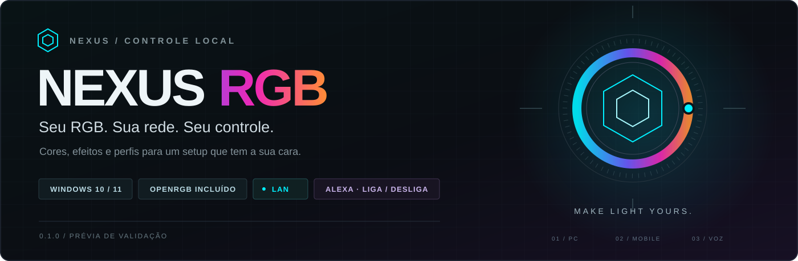

# ⚡ Nexus RGB

<p align="center">
  
</p>

<p align="center">
  <b>A iluminação do seu setup, do seu jeito.</b><br>
  Controle os componentes RGB do PC pelo computador, celular ou tablet.<br>
  Escolha suas cores no Nexus e use a Alexa para acender ou apagar as luzes.
</p>

<p align="center">
  <a href="https://github.com/JonJonGf/nexus-rgb/releases/download/v0.1.0-alpha.1/NexusRGB-Setup-0.1.0.exe"><b>⬇️ Baixar instalador para Windows</b></a> ·
  <a href="https://github.com/JonJonGf/nexus-rgb/releases/tag/v0.1.0-alpha.1">Arquivos da versão</a>
</p>

<p align="center">
  <a href="#instalacao">Instalar</a> ·
  <a href="#celular">Usar no celular</a> ·
  <a href="#alexa">Configurar Alexa</a> ·
  <a href="#ajuda">Resolver problemas</a> ·
  <a href="#desempenho">Consumo</a> ·
  <a href="#desinstalar">Desinstalar</a> ·
  <a href="docs/DESENVOLVIMENTO.md">Desenvolver</a>
</p>

> **Versão 0.1.0 · Prévia para validação.** O Nexus está em desenvolvimento para uso comercial. Os executáveis ainda não têm assinatura digital própria, e a compatibilidade depende do hardware suportado pelo OpenRGB.

---

## ✨ O que o Nexus faz

| 🖥️ No computador | 📱 No celular | 🗣️ Com a Alexa |
| :--- | :--- | :--- |
| Cor, brilho e efeitos para o setup inteiro ou por componente. | O mesmo painel no navegador, pelo link da sua rede. | Uma única luz: **Iluminação Nexus**, para ligar e desligar. |
| Perfis salvos e seis cenas prontas para começar. | Sem conta, login ou leitura obrigatória de QR Code. | Preserva as cores, os efeitos e os ajustes individuais ao religar. |

- **OpenRGB incluído:** o instalador prepara o controlador e as dependências. Você não precisa instalar Node.js nem configurar um servidor OpenRGB à parte.
- **Cada componente, do seu jeito:** RAM, placa-mãe, controladoras e periféricos compatíveis aparecem a partir da detecção real do OpenRGB.
- **RGB e ARGB separados:** quando o hardware informa um mapa completo de zonas e permite cor por LED, as portas e a iluminação interna aparecem como componentes independentes.
- **O layout acompanha sua cor:** a cor estática escolhida também muda a identidade visual do painel.
- **Início com o Windows:** os serviços são configurados para iniciar automaticamente, mesmo antes do login. Fechar a janela mantém o controle em segundo plano.
- **Controle na LAN:** o painel e os efeitos funcionam na rede local, sem depender de uma conta ou servidor externo do Nexus.

<a id="instalacao"></a>

## 🚀 Instalação — do executável ao primeiro uso

### 1. Confira o que você precisa

| Requisito | Para que serve |
| :--- | :--- |
| Windows 10 ou 11, em um PC x64 | Executar o aplicativo e seus serviços. |
| Hardware RGB compatível com OpenRGB 1.0 | Detectar e controlar os LEDs. Confira a [lista oficial de dispositivos](https://openrgb.org/devices_1.0.html). |
| Permissão de administrador durante a instalação | Instalar os serviços, preparar o driver e criar as regras locais do Nexus. |
| PC e celular na mesma rede local | Acessar o painel pelo telefone. O PC pode estar no cabo e o celular no Wi-Fi. |
| Echo compatível na mesma rede, se quiser Alexa | Usar os comandos de ligar e desligar. |

### 2. Obtenha o instalador

O arquivo para instalar esta versão se chama:

```text
NexusRGB-Setup-0.1.0.exe
```

Baixe o [instalador compilado](https://github.com/JonJonGf/nexus-rgb/releases/download/v0.1.0-alpha.1/NexusRGB-Setup-0.1.0.exe) ou abra a [página da versão](https://github.com/JonJonGf/nexus-rgb/releases/tag/v0.1.0-alpha.1) para ver os executáveis e seus hashes SHA256. Com esse arquivo em mãos, siga os próximos passos.

**Acesso à prévia:** o repositório é privado nesta fase; baixar os arquivos pelo GitHub exige uma conta com acesso autorizado. O responsável pelo projeto também pode distribuir o executável diretamente. O uso do painel na LAN continua sem conta ou login.

Se você prefere instalar a partir do código, clone o repositório e siga [como gerar o instalador](docs/DESENVOLVIMENTO.md#gerar-instalador). O executável gerado fica na pasta `dist`.

### 3. Prepare o computador

1. Feche a versão antiga do Nexus, se estiver em execução.
2. Feche outros OpenRGB e os aplicativos de controle RGB do fabricante para evitar que dois programas disputem os mesmos LEDs.
3. Salve seu trabalho antes de continuar, caso o instalador do driver solicite um reinício.

### 4. Instale

1. Dê dois cliques em **NexusRGB-Setup-0.1.0.exe**.
2. Autorize o pedido de administrador do Windows para iniciar a instalação.
3. Escolha se deseja criar o atalho na área de trabalho e mostrar o ícone ao entrar no Windows.
4. Para controlar RAM e placas-mãe que precisam do driver, mantenha selecionada a opção **Abrir instalador do driver assinado PawnIO** e conclua a janela do instalador oficial.
5. Aguarde a conclusão e selecione **Abrir Nexus RGB**.

O pacote já inclui **Node.js, OpenRGB 1.0, Microsoft Visual C++ e o instalador oficial do PawnIO**. Essas dependências são preparadas pelo instalador; não é necessário baixá-las separadamente. O Nexus não pede que você desative o antivírus ou as proteções do Windows.

### 5. Faça o primeiro ajuste

1. Abra **Nexus RGB** pelo menu Iniciar ou pelo atalho.
2. Confira o indicador **Controlador conectado** e os componentes detectados.
3. Em **Iluminação**, clique ou arraste a bolinha da roda de cores, ajuste **Intensidade** e escolha um efeito.
4. Quer começar com uma combinação pronta? Clique em **Aurora**, **Brasa** ou outra cena na barra inferior.
5. Para personalizar separadamente a RAM, a placa-mãe ou uma porta ARGB, abra **Dispositivos**.

Os ajustes são salvos automaticamente. Quando o controlador está desconectado, o Nexus guarda a configuração para aplicar assim que a conexão voltar.

> **Seu PC precisa estar ligado e acordado.** O celular e a Alexa controlam os LEDs desse computador; o painel fica indisponível quando ele está desligado ou suspenso.

<a id="celular"></a>

## 📱 Um link para o celular, o tablet e outro PC

1. Conecte os aparelhos à mesma rede local do computador.
2. No Nexus aberto pelo aplicativo do PC, entre em **Conexões**.
3. Selecione a rede do computador e clique em **Mostrar link e QR Code**.
4. Copie o link ou leia o QR Code uma vez para abrir o painel no celular.
5. Salve nos favoritos ou use **Adicionar à tela inicial** no navegador, quando essa opção estiver disponível.

O endereço tem este formato:

```text
http://IP-DO-SEU-PC:5050/
```

Por exemplo, se o PC tiver o IP `192.168.1.100`:

```text
http://192.168.1.100:5050/
```

Use o endereço mostrado pelo seu Nexus; o IP acima é apenas um exemplo. No próprio computador, você também pode abrir `http://127.0.0.1:5050/`. Esse endereço funciona somente no PC que executa o aplicativo.

**Não precisa ler o QR Code toda vez.** O favorito ou atalho abre o mesmo link, sem login ou pareamento. Para manter o endereço mesmo após reiniciar o roteador ou o computador, reserve o IP do PC nas configurações DHCP do roteador.

O atalho no telefone abre o painel web. Esta versão não inclui um APK ou aplicativo iOS nativo. Wi-Fi de convidados e redes com isolamento entre aparelhos podem impedir o acesso.

<a id="iluminacao"></a>

## 🎨 Cores, efeitos e perfis

### Controle geral e por componente

| Onde ajustar | O que você pode fazer |
| :--- | :--- |
| **Iluminação** | Sincronizar o setup, escolher cor, brilho, ritmo e efeito. Um ajuste geral substitui as personalizações individuais. |
| **Dispositivos** | Escolher configurações próprias para cada componente, incluindo ligar ou desligar individualmente. |
| **Perfis** | Ativar cenas prontas ou clicar em **+ Salvar perfil atual** para guardar a combinação geral e os ajustes individuais. Criar e excluir perfis exige abrir o aplicativo no PC. |
| **Zonas**, em Dispositivos | No aplicativo do PC, informar a quantidade real de LEDs de uma zona redimensionável, quando o controlador permite. |

### Efeitos disponíveis

| Efeito | Como fica |
| :--- | :--- |
| **Estático** | Uma cor contínua. |
| **Arco-íris** | Cores mudando por todo o espectro. |
| **Onda** | Cores percorrendo os LEDs. |
| **Respiração** | O brilho sobe e desce suavemente. |
| **Pulso** | Pulsos de intensidade. |
| **Modo nativo** | Os modos oferecidos pelo próprio dispositivo, quando disponíveis. |

Os efeitos dependem das capacidades do componente. Em zonas independentes de uma mesma controladora, modos nativos que alterariam toda a placa não são oferecidos por zona.

### Coleção Nexus — seis cenas para começar

| Cena | Paleta e movimento | Clima |
| :--- | :--- | :--- |
| 🌌 **Aurora** | Verde, turquesa e violeta em ondas. | Fluido |
| 🔥 **Brasa** | Âmbar com respiração lenta. | Quente |
| 🪐 **Nebulosa** | Violeta, magenta e azul em uma onda lenta. | Imersivo |
| 🌊 **Abissal** | Azul profundo e ciano, com pouca luz. | Suave |
| ☀️ **Solar** | Laranja em pulsos. | Energia |
| 🌙 **Silêncio** | Branco quente com baixo brilho. | Noturno |

<a id="alexa"></a>

## 🗣️ Alexa — acenda e apague seu setup

A integração é opcional e vem desativada. Você precisa de um Echo compatível na mesma rede do PC. O Nexus apresenta uma ponte Hue local; não é necessário comprar uma ponte física para controlar o Nexus.

### Como conectar

1. Abra **Conexões** pelo aplicativo Nexus no computador.
2. Ative a opção **Amazon Alexa** e confira o estado **Ponte local ativa**.
3. Clique em **Buscar Echo por 2 minutos**.
4. No aplicativo Alexa do telefone, inicie a adição de um dispositivo **Philips Hue Bridge V1 (redonda)**.
5. Quando um IP aparecer no Nexus, confira no roteador ou aplicativo Alexa se ele pertence ao seu Echo e clique em **Autorizar Echo**.
6. Se a primeira busca não concluir, abra novamente a janela de descoberta de dois minutos e repita a busca no aplicativo Alexa.
7. Confirme que a luz **Iluminação Nexus** apareceu e teste os comandos abaixo.

> **“Alexa, acenda a Iluminação Nexus.”**
>
> **“Alexa, apague a Iluminação Nexus.”**

A Alexa controla **somente ligar e desligar**. Cores, brilho, efeitos e perfis ficam no painel Nexus. Ao religar pela Alexa, seus ajustes individuais são preservados; componentes que estavam apagados continuam apagados.

Use o nome **Iluminação Nexus** para distinguir a luz de dispositivos que desligam o computador, como os do Simple WOL. Se você usou a versão que anunciava cinco dispositivos de efeitos, exclua essas entradas antigas no aplicativo Alexa e mantenha a luz principal.

Reserve os IPs do PC e do Echo no roteador. A descoberta pode variar com o modelo e firmware do Echo; a [documentação da emulação Hue](https://www.home-assistant.io/integrations/emulated_hue/) explica as limitações desse protocolo. A integração não é certificada pela Amazon ou Philips.

**E fora de casa?** O painel Nexus atende somente a rede local. Comandos remotos pelo aplicativo Alexa dependem do Echo, da infraestrutura da Amazon e da compatibilidade da integração; precisam ser validados no aparelho.

## 🪟 No dia a dia

- **Abrir o painel:** use o atalho, o menu Iniciar ou dê dois cliques no ícone do Nexus ao lado do relógio.
- **Usar a bandeja:** clique com o botão direito para abrir o painel, copiar o link do celular ou abrir a pasta de diagnósticos.
- **Fechar a janela:** os serviços continuam funcionando. A opção **Fechar ícone (manter as luzes)** também mantém o controle ativo.
- **Iniciar com o Windows:** o instalador configura os serviços e a restauração dos ajustes. Não é necessário abrir o painel para ativar os serviços.
- **Atualizar:** feche o painel e execute o instalador da nova versão. Seus dados locais são mantidos. Se uma página já estava aberta, recarregue-a após atualizar.
- **Desinstalar:** use o [assistente de desinstalação](#desinstalar), o atalho **Desinstalar Nexus RGB** no menu Iniciar ou as configurações de aplicativos do Windows.

<a id="desinstalar"></a>

## 🧹 Desinstalar o Nexus RGB

1. Baixe [NexusRGB-Uninstall-0.1.0.exe](https://github.com/JonJonGf/nexus-rgb/releases/download/v0.1.0-alpha.1/NexusRGB-Uninstall-0.1.0.exe).
2. Abra o arquivo e autorize o pedido de administrador do Windows.
3. Confirme a remoção na janela do desinstalador e aguarde a conclusão.

Esse assistente localiza a instalação oficial e abre o desinstalador do Nexus registrado no Windows. Se o aplicativo não estiver instalado ou os arquivos estiverem incompletos, ele informa o problema.

A remoção desativa e remove os serviços e as regras próprias de firewall. Seus perfis e dados locais são preservados para uma futura reinstalação. O driver PawnIO e o runtime Microsoft Visual C++, que podem ser compartilhados com outros programas, também são mantidos.

<a id="desempenho"></a>

## 📊 Quanto o Nexus consome?

Medição real em **13/10/2026**, em um PC com **Ryzen 5 3600 (6 núcleos / 12 threads), 32 GB de RAM e Windows 11 Pro**, controlando **92 LEDs em 3 controladoras e 5 componentes**. Foram amostrados os serviços, Node.js, OpenRGB e o ícone da bandeja, com o painel do navegador fora da soma.

| Cenário | CPU média | Pico de CPU em 1 s | RAM residente média | Pico de RAM residente |
| :--- | ---: | ---: | ---: | ---: |
| Luzes apagadas · 40 s | 0,065% | 0,395% | 187,38 MiB | 187,41 MiB |
| Cor estática, luzes ligadas · 30 s | 0,035% | 0,393% | 187,68 MiB | 187,71 MiB |
| Onda, luzes ligadas · 30 s | 0,468% | 1,037% | 187,86 MiB | 188,03 MiB |

**Como ler:** CPU é a porcentagem da capacidade total das 12 threads, calculada a partir do tempo de CPU dos processos. RAM é a soma dos conjuntos residentes (*Working Set*), que pode contar páginas compartilhadas mais de uma vez. **1 MiB = 1.048.576 bytes.** As pequenas diferenças entre apagado e estático são variações normais de uma amostragem curta.

Efeitos animados geram cores em até 20 atualizações por segundo. Na cor estática, o Nexus mantém a configuração aplicada e evita reescrever os LEDs enquanto nada muda. Hardware, quantidade de LEDs, modo e velocidade podem alterar o consumo.

Esses resultados foram coletados durante a revisão, antes das últimas correções de recuperação de conexão e instalação. São uma referência desse PC, não uma garantia para todas as máquinas. O navegador acrescenta seu próprio consumo quando o painel está aberto. GPU, energia em watts, inicialização e comportamento durante horas de uso não foram medidos. Consulte o [relatório completo e o método](docs/DESEMPENHO.md).

<a id="ajuda"></a>

## 🛠️ Algo não funcionou?

| Sintoma | O que conferir |
| :--- | :--- |
| **Nenhum dispositivo foi detectado** | Feche outros programas RGB, confirme a instalação do PawnIO se o hardware precisa dele e consulte a compatibilidade do modelo no OpenRGB. |
| **RAM aparece, mas a porta ARGB fica apagada** | Em **Dispositivos**, confira as zonas e informe a quantidade real de LEDs da porta, quando ela permite redimensionamento. Nem todo header identifica sozinho os LEDs conectados. |
| **O celular não abre o painel** | Use o IP mostrado em **Conexões**, com `http://` e a porta `5050`. Confira se o PC está acordado e se os aparelhos estão na mesma sub-rede, sem isolamento de convidados. |
| **O link parou depois de reiniciar** | Confira se o IP do PC mudou. Abra o novo endereço mostrado no Nexus e faça uma reserva DHCP no roteador para manter o link. |
| **O instalador informa porta ocupada** | Feche o Nexus antigo ou outro OpenRGB. O instalador verifica as portas `5050` e `6743` e não encerra programas de terceiros. |
| **A ponte Alexa diz “Porta 80 ocupada”** | Outro programa está usando a porta da ponte Hue. Identifique o conflito; o painel RGB na porta `5050` continua independente da ponte. |
| **A Alexa não encontrou a luz** | Use a busca **Philips Hue Bridge V1 (redonda)**, abra a janela de descoberta no Nexus e confira a autorização do IP do Echo. Em **Conexões**, veja a última busca e consulta recebidas. |
| **A Alexa oferece desligar o computador** | Confira se **Iluminação Nexus** existe no app Alexa e use esse nome nos comandos, para evitar confusão com Simple WOL ou outro dispositivo. |
| **A roda de cores parece arrastar a página** | Atualize para a versão mais recente e recarregue o painel com **Ctrl + F5**. A roda deve acompanhar o arraste sem selecionar o conteúdo da página. |

Ainda precisa investigar? Pelo ícone da bandeja, abra **Abrir pasta de diagnósticos**. Os dados do painel ficam em `%ProgramData%\NexusRGB\app`; erros de instalação ficam em `%ProgramData%\NexusRGB\installation-error.log`. Para relatar um problema, informe a versão do Nexus, o modelo do componente e a mensagem apresentada.

## 🛡️ Sua rede, seus dados

O painel usa HTTP local e permite que aparelhos da mesma sub-rede privada controlem as luzes **sem autenticação**. Isso torna o link simples de usar; não há criptografia do tráfego local. Ajustes administrativos ficam disponíveis pelo aplicativo do PC, via endereço local.

O instalador cria regras específicas do Nexus para a LAN. Não há telemetria, túnel externo ou atualização automática, e o aplicativo não precisa se conectar ao GitHub para funcionar. **Não abra portas do Nexus no roteador.** A Alexa pode precisar de internet para o próprio funcionamento, mesmo com a ponte Nexus na LAN.

O suporte depende do dispositivo, e não apenas da marca. Fans ligados à mesma porta ARGB podem aparecer como uma única zona. O Nexus separa componentes quando o controlador fornece as informações necessárias; a instalação automática não garante compatibilidade com todo hardware RGB existente.

---

## 📚 Para quem desenvolve ou distribui

- [Ambiente de desenvolvimento, testes e geração do instalador](docs/DESENVOLVIMENTO.md)
- [Relatório de consumo e metodologia](docs/DESEMPENHO.md)
- [Condições para liberar a versão comercial](docs/COMERCIAL.md)
- [Componentes e licenças de terceiros](THIRD-PARTY-NOTICES.md)

<p align="center">
  <b>MAKE LIGHT YOURS.</b><br>
  Nexus RGB · Desenvolvido por <a href="https://github.com/JonJonGf">JonJonGf</a>
</p>
