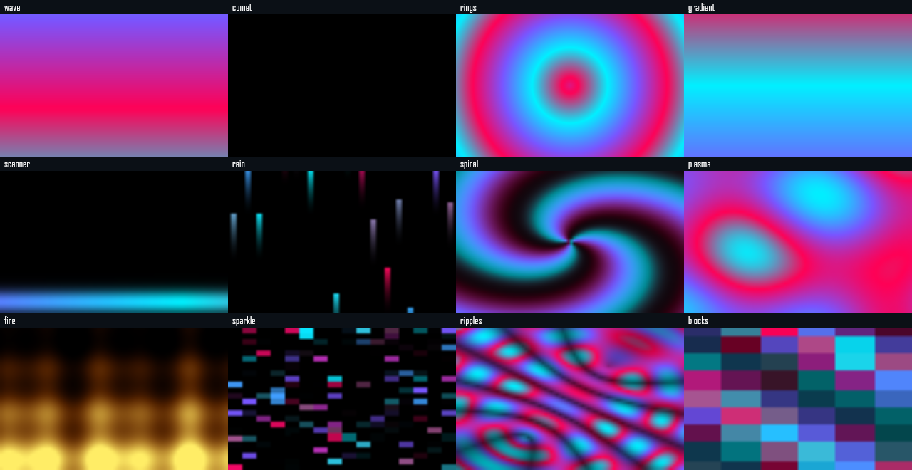

# Variedade, HTML/Canvas e ajuda — 16/10/2026

## Escopo

O criador passa a oferecer doze padrões JSON e um formato separado para colar efeitos HTML/Canvas compatíveis com o SignalRGB. A prévia HTML não importa arquivos nem muda o efeito ativo. O guia local, a seção de Ajuda e o arquivo `LEIA-ME.txt` tornam as instruções acessíveis sem um visualizador Markdown.

Na imagem, um único instante pode coincidir com o intervalo escuro do cometa. Chuva usa direção 90°; fogo usa −90°. A paleta do fogo é amarela/laranja/vermelha; os demais usam ciano/roxo/rosa. A imagem não representa leitura de hardware.

## Testes locais

A suíte completa executada durante o desenvolvimento passou em 120 testes de lógica/integração e 33 de interface. Depois, foram adicionados e executados os testes de travamento por quadro, perda de autorização, stream duplicado, preservação dos parâmetros HTML ao aplicar e alternância dos rascunhos. Os quatro testes específicos da prévia e os três da interface HTML passaram. A configuração final foi confirmada no CI: 121 testes de lógica e 34 de interface aprovados.

Foram verificados:

- Identificadores dos efeitos anteriores preservados; doze padrões desenham, animam e respeitam velocidade zero. `gradient` permanece estático. O desenho compartilhado do editor corresponde ao motor.
- Importação de HTML e controles `color`, `number`, `boolean` e `combobox` pelos mecanismos existentes; booleanos entram como `0`/`1`.
- Prévia HTML por SSE com imagens PNG, sem gravação na biblioteca, ajustes ou comandos ao hardware. Pausar/fechar encerra o processo, e retomar reinicia o script.
- Recusa de LAN, origem forjada, token errado, scripts externos e acesso à rede pelo efeito. Loop infinito na inicialização ou no quadro é interrompido; autorização perdida fecha o stream; stream duplicado é recusado.
- Salvar na biblioteca preserva o efeito ativo. Salvar e aplicar guarda os parâmetros escolhidos e preserva a energia desligada. Alternar JSON/HTML mantém os rascunhos enquanto o editor está aberto.
- Apresentação inicial uma vez por pasta de dados, sem repetir entre sessões, reinício do processo ou atualização com dados preservados. Instalações já existentes com ajustes salvos, mesmo sem marcador, são tratadas como já apresentadas.
- Ajuda local com português/inglês e layout móvel sem exceder a largura da tela. A apresentação pode ser fechada; os links de ajuda permanecem nas Configurações.

Um exemplo HTML fornecido pelo usuário foi testado privadamente em processo isolado e no editor, com dez controles, duas direções, animação e autoria preservada. O código de terceiros não acompanha o pacote nem foi publicado no repositório. Os testes usam dados temporários e não alteram os LEDs da instalação em uso.

## Limites

A compatibilidade é parcial para Canvas 2D e metatags; não implementa o aplicativo SignalRGB, áudio, WebGL, jogos, periféricos ou suas APIs completas. Há uma prévia temporária por servidor, expiração de cinco minutos, timeout de inicialização de seis segundos, watchdog de quadro de um segundo e os limites existentes do sandbox. O código não executa no JavaScript do navegador ou do Node; a imagem decodificada é exibida no editor. Essas restrições não equivalem a uma auditoria independente.

O FPS do motor orienta os quadros do script HTML, enquanto a transmissão é limitada a dez imagens por segundo. Scripts que incrementam posições por quadro ainda podem mudar de velocidade quando o FPS configurado muda. Erros no código original, como cor não inicializada ou hexadecimal incompleto, não são corrigidos automaticamente.

Consulte a [medição isolada dos padrões](../DESEMPENHO.md#desenho-dos-doze-padrões--16102026) e os [dados brutos](2026-10-16-patterns.json). Não representam consumo total nem taxa física dos LEDs.

## Triagem CodeQL da alpha.19

Foram revisados individualmente três alertas novos `js/path-injection` no commit `fea106e1cdc61ada7eb7f09fa56b7f9c4245db24`. A revisão usou os fluxos completos do SARIF da [execução da versão](https://github.com/JonJonGf/nexus-rgb/actions/runs/38926953460), artefato `12056149993`; SHA256 do ZIP `56981b8a685fcd6fa06b2623995fa874701cfe8e5959d37f4e106bb568c84671`.

| Alerta | Local | Origem e conclusão |
| --- | --- | --- |
| 81 | `server/first-use.js:6` | Os fluxos partem de `NEXUS_DATA_DIR` ou dos diretórios de fixtures/benchmarks definidos pelo chamador local. O alvo é a folha fixa `first-use.json`. A leitura verifica o mesmo handle e recusa links e tamanho excessivo. Não há caminho recebido por HTTP; falso positivo para injeção remota. |
| 82 | `server/first-use.js:7` | Verifica a existência da folha fixa `settings.json` na mesma pasta de dados. Fontes rastreadas: ambiente/configuração do processo e pastas temporárias dos testes. Nenhum campo da API escolhe a pasta ou o arquivo; falso positivo. |
| 83 | `server/index.js:46` | Cria o diretório de dados configurado ao iniciar o processo. O fluxo SARIF começa em `BENCH_DATA`, definido pelo benchmark a partir de `mkdtempSync`. É uma escolha intencional do chamador local, sem operação HTTP que altere esse alvo; falso positivo. |

Na instalação, o supervisor nativo define `NEXUS_DATA_DIR` como `%ProgramData%\NexusRGB\app`; as permissões da pasta e do serviço são a fronteira de confiança. Esses alertas não foram tratados como vulnerabilidades corrigidas nem descartados apenas para reduzir a contagem. As consultas estendidas e as fontes locais continuam habilitadas, e o bloqueio de publicação exige a análise do mesmo commit/tag sem alertas abertos após a triagem.

## Confirmação da versão publicada

A [alpha.19](https://github.com/JonJonGf/nexus-rgb/releases/tag/v0.1.0-alpha.19) foi publicada a partir do commit `fea106e1cdc61ada7eb7f09fa56b7f9c4245db24` pela [execução 38926953460](https://github.com/JonJonGf/nexus-rgb/actions/runs/38926953460). O [CI 38926953929](https://github.com/JonJonGf/nexus-rgb/actions/runs/38926953929) aprovou 121 testes de lógica/integração, 34 de interface, o supervisor nativo e a estabilidade de 60 segundos, com 171 requisições e dez reinícios abruptos do processo de teste.

As duas VMs Windows concluíram **75 verificações cada, sem falhas**, nas portas painel/SDK/Alexa `5050/6743/80` e `5151/6754/8081`. Incluem instalação, atualização, reinício de serviço, desinstalação, reinstalação com dados preservados, ajuda offline, arquivo de texto, prévia HTML instalada e apresentação inicial sem repetição. Esses testes não usam hardware RGB físico.

O bloqueio de publicação aprovou as três análises CodeQL do mesmo commit/tag, sem erros ou avisos de análise e sem alertas abertos após a triagem documentada acima. Isso não constitui certificação ou garantia de ausência de vulnerabilidades.

Os quatro arquivos oficiais foram baixados para conferência: instalador, desinstalador, `SHA256SUMS.txt` e `BUILD-INFO.json`. Tag, commit, execução, tamanhos e hashes coincidiram com os metadados e os digests dos assets do GitHub. A conferência não executou o instalador.

| Arquivo | Bytes | SHA256 |
| --- | ---: | --- |
| `NexusRGB-Setup-0.1.0.exe` | 94576756 | `54831bce1e4c46a9b0696a6ef8351aae95b371be1e88c3d7f45ae9000d382498` |
| `NexusRGB-Uninstall-0.1.0.exe` | 240640 | `34a0bda8f46c81f077edaa82558a50a473e4b8d0fbc33d19a43c2c94b8d5260c` |
